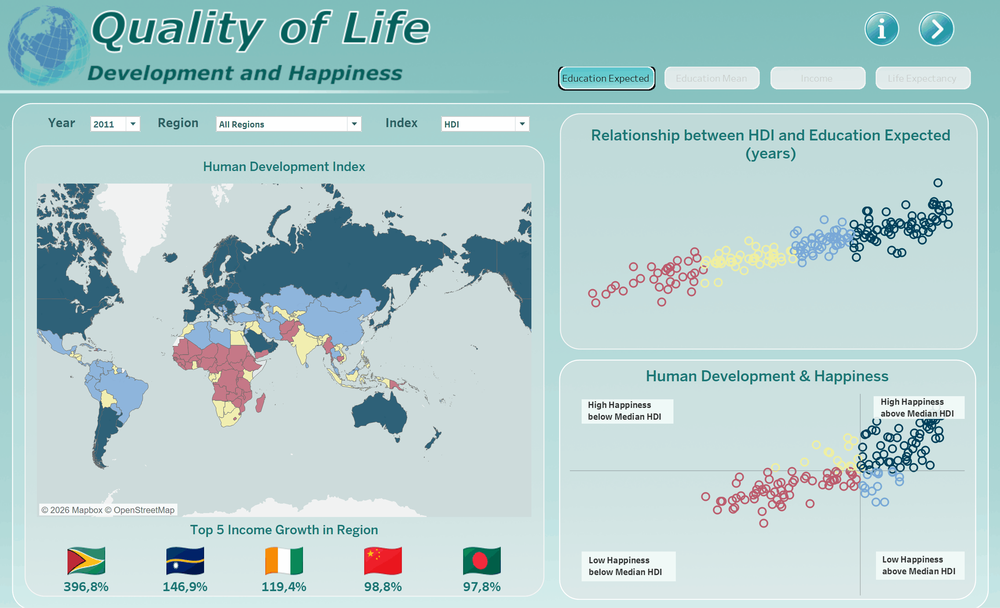

# 🌍 Quality of Life: Development and Happiness

## An Interactive Global Analysis | 2011–2023

An end-to-end data analytics project exploring human development, gender equality, and happiness across countries and regions from 2011 to 2023.

With an educational background in Quality Management, I have been interested in the concept of quality of life and the challenges of measuring it since my university years. What makes a good life, and how can something so complex be assessed through data?

Today, the growing availability of open data offers an opportunity to explore these questions, examine different perspectives, and draw independent, evidence-based conclusions. This project is my attempt to bring that interest together with my skills in data analytics.

Using Python (Pandas) for data cleaning and preparation and Tableau for interactive visualization, I combined three key indicators — the Human Development Index (HDI), Gender Development Index (GDI), and Happiness Score — to investigate global patterns, regional differences, and country-level trends.

🔗 <a href="https://public.tableau.com/app/profile/anna.muravyeva/viz/QualityofLifeDevelopmentandHappiness/Overview"></a> [**Explore the Interactive Dashboard on Tableau Public**](https://public.tableau.com/app/profile/anna.muravyeva/viz/QualityofLifeDevelopmentandHappiness/Overview)

<br>




## 📁 Repository Structure

```text
quality-of-life-dashboard/
│
├── data/
│   ├── raw/              # Original datasets
│   └── processed/        # Cleaned datasets used in Tableau
│
├── notebooks/            # Jupyter notebooks for data preparation
├── tableau/              # Tableau workbook (.twbx)
├── images/               # Dashboard screenshots, GIF and logo
│
├── README.md             # Project documentation
├── requirements.txt      # Python dependencies
└── .gitignore            # Excluded files
```
⚙️ Installation & Setup

To explore the data preparation process, clone this repository and install the required Python dependencies.

1. Clone the repository

```bash
git clone https://github.com/Anna88Mur/quality-of-life-dashboard.git
cd quality-of-life-dashboard
```

2. Install the dependencies

```bash
python -m pip install -r requirements.txt
```
3. Launch Jupyter Notebook

```bash
jupyter lab
```
Open the notebooks in the notebooks/ directory to explore the data cleaning and preparation workflow.

To explore the interactive visualizations, open the Tableau workbook in the tableau/ directory or visit the published dashboard on Tableau Public.

## 📊 Data Sources

This project combines data from two publicly accessible sources, focusing on the period 2011–2023.

1. [UNDP — Human Development Reports (HDR)](https://hdr.undp.org/data-center/documentation-and-downloads)

Data published by the United Nations Development Programme (UNDP), including:

Human Development Index (HDI) and its components: life expectancy, expected and mean years of schooling, and gross national income (GNI) per capita.

Gender Development Index (GDI) and its female and male development indicators.

2. [World Happiness Report 2005–2025 Panel — Kaggle](https://www.kaggle.com/datasets/elvisbui/world-happiness-report-2005-2025-panel?resource=download)

A publicly available dataset used to analyze Happiness Scores, calculate annual country rankings, and explore happiness trends over time.

Data Preparation

The datasets were cleaned and standardized using Python (Pandas). Country names and ISO codes were harmonized to support comparisons across sources.

The analysis preserves missing values rather than replacing them with zeros. As data availability varies by country and year, some visualizations may not contain observations for every selected period.